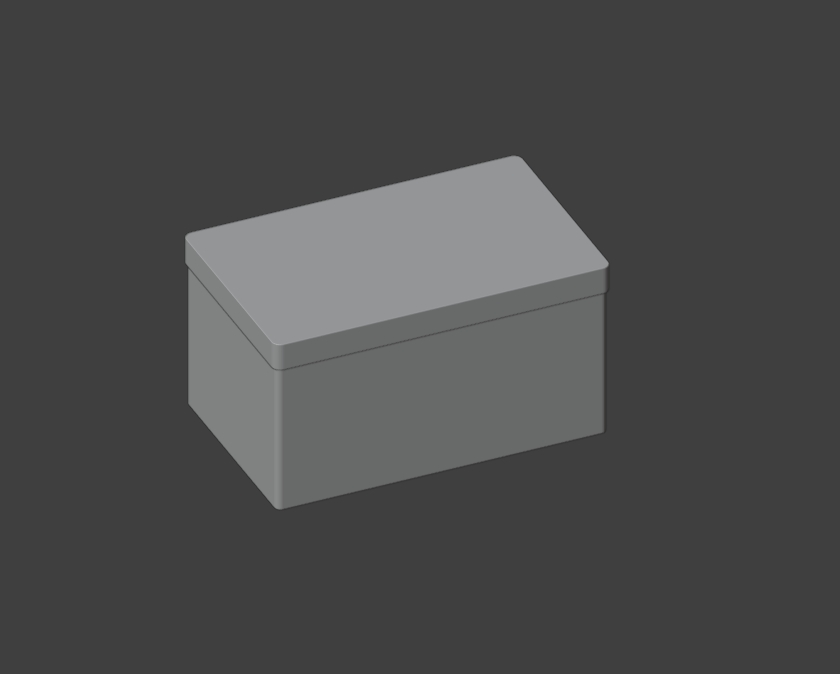

# Simple_boxes

**Параметрические коробки со съёмными крышками для Blender. Разработчик — Alemus.**

Создавайте коробки для хранения и подготовки к FDM-печати. Изменяйте размеры, скругления, количество секций и посадочный зазор — основание и крышка перестраиваются автоматически.

<table><tr><td width="40%"></td><td width="40%"></td><td width="20%"></td></tr></table>

## Возможности

- Длина, ширина, высота, стенки и внутренняя глубина в миллиметрах.
- Равные внутренние секции с настраиваемыми перегородками.
- Геометрические скругления основания и крышки.
- Посадочный зазор на сторону, глубина посадки и толщины крышки.
- Крышка рядом или в закрытом положении.
- Несколько независимых коробок и сохранение параметров в .blend.
- Переводы для 37 локалей Blender 3.6 плюс английский оригинал. Переводы, кроме русского, машинные и требуют вычитки; новые языки Blender пока могут использовать английский fallback.

## Установка и обновления — Blender 4.2+

Preferences → Get Extensions → Repositories → Add Remote Repository. Укажите:

`https://raw.githubusercontent.com/AlemusSs/Simple_boxes/main/index.json`

Разрешите Online Access и включите Check for Updates on Startup. Найдите Simple_boxes и установите. Новые релизы загружаются с GitHub штатной кнопкой Update/Update All в Blender. Проверка обновлений автоматическая; установка требует команды пользователя. Полностью фоновая автоматическая установка пока не реализована.

Для первой установки также можно скачать ZIP Extension из Releases и выбрать Install from Disk. Для последующих штатных обновлений установите аддон именно из указанного репозитория. Если ранее ставили legacy-вариант, сохраните файл и отключите старую копию перед установкой Extension.

Blender 3.6: скачайте legacy ZIP → Preferences → Add-ons → Install → включите Simple_boxes. Штатные обновления Extensions в 3.6 недоступны.

## Первая коробка

В 3D View нажмите N → Simple_boxes → Create box / Создать коробку. Выберите основание или крышку и изменяйте параметры. Числа заданы в миллиметрах. Не масштабируйте объекты для параметрического изменения размеров.

## Проверки и ограничения

Автотесты запускаются на Blender 3.6.1: секции 1×1—4×4, manifold, радиусы, дуговые профили, сохранение/открытие и независимые пары. Установка и обновление через Extensions в Blender 4.2+ пока не проверены в запущенном Blender. Самопересечения и STL-экспорт автоматически не проверяются. Перед печатью проверьте сетку и посадку тестовым образцом. Подробности реализации и ограничений — в README_RU.md.

## Лицензия

GPL-3.0-or-later.
