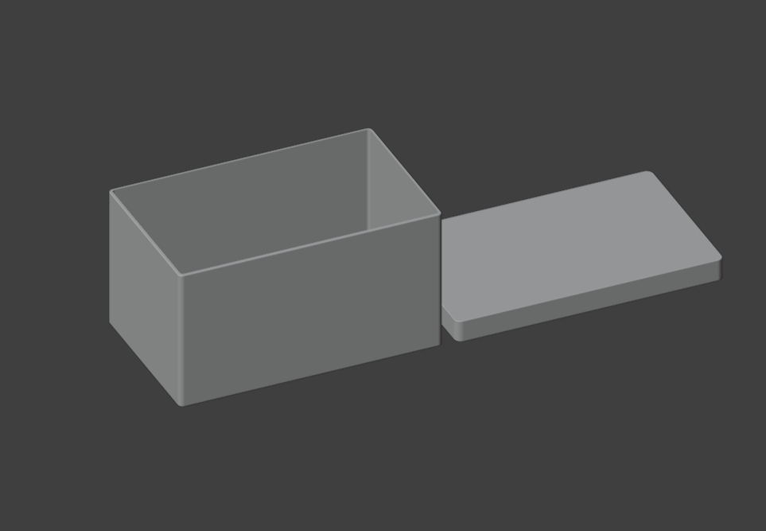
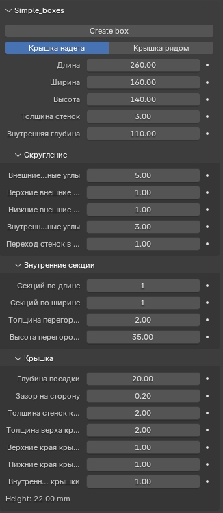

# Simple Boxes

**Параметрические коробки со съёмными крышками для Blender.**

Создавайте коробки для хранения и подготовки к FDM-печати. Изменяйте размеры, скругления, количество секций и посадочный зазор — основание и крышка перестраиваются автоматически.
Быстро. Просто. Удобно.

<table><tr><td width="40%"></td><td width="40%"></td><td width="20%"></td></tr></table>

## Возможности

- Длина, ширина, высота, стенки и внутренняя глубина в миллиметрах.
- Равные внутренние секции с настраиваемыми перегородками.
- Геометрические скругления основания и крышки.
- Посадочный зазор на сторону, глубина посадки и толщины крышки.
- Крышка рядом или в закрытом положении.
- Несколько независимых коробок и сохранение параметров в .blend.
- Переводы для 37 локалей Blender.

## Установка — Blender 4.2+

Установка:
- Открой Blender → Edit → Preferences → Add-ons.
- Выбери Install from Disk и укажи скачанный Zip архив (скачать можно в любое место на ПК и потом удалить это файл).
- Активируй дополнение.
- Откройте 3D Viewport, нажми N и открой вкладку Simple boxes.
- Нажми "Create box", чтобы создать коробочку.

Для Blender 3.6 скачайте "legacy ZIP"

## Проверки и ограничения

Автотесты запускаются на Blender 3.6.1: секции 1×1—4×4, manifold, радиусы, дуговые профили, сохранение/открытие и независимые пары. Самопересечения и STL-экспорт автоматически не проверяются. Перед печатью проверьте сетку и посадку тестовым образцом. Подробности реализации и ограничений — в README_RU.md.

## Лицензия

GPL-3.0-or-later.
